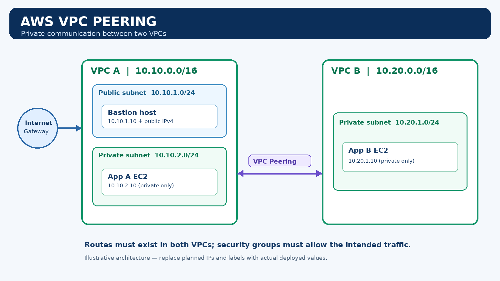

# AWS VPC Peering — Portfolio Project

**Purpose:** Demonstrate private communication between two Amazon VPCs using VPC Peering, route tables, security groups, and a bastion host.

> **Honesty note:** This package contains an architecture diagram and clearly labeled screenshot placeholders. It does not claim that AWS resources have been deployed. Replace each placeholder with a real screenshot from your own AWS account and complete the report with observed results before submitting as a completed hands-on project.

## Architecture

### Network plan

| Resource | Name | CIDR / address |
|---|---|---|
| VPC A | `ewb-vpc-a` | `10.10.0.0/16` |
| Public subnet A | `ewb-a-public` | `10.10.1.0/24` |
| Private subnet A | `ewb-a-private` | `10.10.2.0/24` |
| VPC B | `ewb-vpc-b` | `10.20.0.0/16` |
| Private subnet B | `ewb-b-private` | `10.20.1.0/24` |
| Bastion | `ewb-bastion` | `10.10.1.10` planned |
| App A | `ewb-app-a` | `10.10.2.10` planned |
| App B | `ewb-app-b` | `10.20.1.10` planned |
| Peering | `ewb-a-b-peer` | Must reach `Active` |

The IP addresses above are the planned addresses from the lab design. Confirm actual assignments in the AWS Console.

## Project objectives

- Design two non-overlapping VPC CIDR ranges.
- Create one public subnet and two private subnets.
- Use an Internet Gateway for public bastion access in VPC A.
- Create and accept a VPC Peering connection.
- Add routes in both VPCs.
- Apply least-privilege SSH and ICMP security group rules.
- Test forward and reverse private connectivity.
- Demonstrate a controlled failure and recovery.
- Clean up resources and review billing.

## Route table requirements

| Route table | Destination | Target |
|---|---|---|
| `ewb-rt-a-public` | `10.20.0.0/16` | VPC Peering |
| `ewb-rt-a-private` | `10.20.0.0/16` | VPC Peering |
| `ewb-rt-b-private` | `10.10.0.0/16` | VPC Peering |
| `ewb-rt-a-public` | `0.0.0.0/0` | Internet Gateway |

The automatic local route must remain in each VPC. Do not create a NAT Gateway for this introductory project.

## Security rules

- Bastion inbound SSH (TCP 22): only your current public IPv4 address with `/32`.
- App hosts inbound SSH: restrict to the bastion security group where possible.
- App A and App B inbound ICMP Echo Request: allow only the peer host address needed for the test.
- Never open SSH to `0.0.0.0/0`.
- Keep private EC2 instances without public IPv4 addresses.

## Test plan

1. Before peering routes are in place, test cross-VPC connectivity and record the actual result.
2. After the peering connection is `Active` and routes/security rules are correct, ping App B from App A.
3. Ping App A from App B.
4. Temporarily remove the relevant ICMP rule, test failure, then restore it and verify recovery.
5. Document any troubleshooting performed.

Example command from App A: `ping -c 4 10.20.1.10`

A failed ping can also result from security groups, network ACLs, OS firewall settings, or incorrect routes; investigate all of these before drawing conclusions.

## Screenshots

The `docs/screenshots/` directory contains ten **clearly labeled placeholders** to show exactly what evidence to capture. Replace them with real screenshots from your deployment. Do not submit placeholders as proof of implementation.

## Cost and cleanup

Check current AWS prices and account offers before launching resources. Budget alerts are not spending caps. EC2 instances, EBS volumes, and public IPv4 addresses may incur charges. When finished, terminate instances, delete lab resources in dependency order, release any allocated Elastic IP addresses, and check the Billing console.

## GitHub Pages

This repository includes `index.html`. To publish it, open **Settings → Pages**, select **Deploy from a branch**, choose `main` and `/ (root)`, then save. Wait for GitHub Pages to publish. The page documents the design and explicitly distinguishes planned architecture from verified implementation.

## Resume bullet — only after you have completed and verified the lab

> Designed and configured two Amazon VPCs with non-overlapping CIDR ranges, VPC Peering, bidirectional routes, least-privilege security groups, and bastion-host access; validated private connectivity and documented troubleshooting and cleanup.
